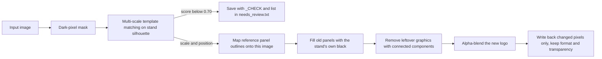

# Stand Replacer

Batch-edit product renders to swap the branding on a bike stand, using classical computer vision (Python and OpenCV). No machine-learning model, no manual masking.

Given a folder of motorcycle graphics-kit images, the tool finds the display stand in each one, repaints its printed panels, draws a crisp replacement logo, and writes the result in the original format. Images it cannot match with confidence are flagged for a person to handle.

**Contents:** [Overview](#overview) · [Supported cases](#supported-cases) · [Results on real images](#results-on-real-images) · [How it works](#how-it-works) · [Tech stack](#tech-stack) · [Usage](#usage) · [Performance](#performance) · [Limitations and known issues](#limitations-and-known-issues) · [Project structure](#project-structure)

---

## Overview

A catalogue of roughly 400 product renders each showed a bike on a branded stand. The stand branding had to be changed on every image.

Editing 400 files by hand is slow and inconsistent, and the images were not uniform:

| Variation in the data | Why it is a problem |
|---|---|
| Image widths from about 1200 px to 5000 px | A fixed paste position cannot work |
| Different bike brands, kits and colours | The stand sits at a different place in every image |
| Stand with or without a top strip; different printed logo styles | Matching on the old logo fails |
| Soft ground shadows and fine edges | A pasted cut-out looks fake |
| Replacement stand photo only about 290 px wide | Enlarging it to about 740 px looks blurry |
| JPG, PNG and WebP, some with transparency | Output has to keep each file's format |

**Design choice:** the first attempt pasted a photo of the new stand over the old one. It looked soft and cut-out, and the client said so. The final design **edits the stand already in the image** instead of replacing it, which keeps the original frame, edges, lighting and shadows exactly as rendered.

## Supported cases

This version is built around **one physical stand model**: a tubular steel stand with a printed front panel, seen from the side.

| Case | Supported |
|---|---|
| Side-view render on a white or near-white background | Yes |
| Image sizes from 1200 px to 5000 px wide | Yes |
| JPG, PNG and WebP input, including transparent PNG and WebP | Yes (format and transparency are kept) |
| Stand with or without the printed top strip | Yes |
| Different printed panel styles (logos, triangles, carbon textures) | Yes |
| Soft grey ground shadows | Yes (left untouched) |
| Many bike brands and kit colours | Yes (stand shape is the same across them) |
| Subfolders inside the input folder | Yes |

**Not supported (flagged for manual handling):**

| Case | What happens |
|---|---|
| A different stand model, for example a moulded plastic stand with cut-outs | Match score is low, so the image is flagged |
| Bike shown from a three-quarter angle, not a side view | Flagged |
| Dark or photographic backgrounds (for example a garage scene) | Flagged |

## Results on real images

Two sets of images were used. The first was used to build and tune the tool. The second is a sample from the real batch that the tool had never seen.

**Development set (11 images):** Honda ×8, Yamaha ×3.

| Outcome | Count | Notes |
|---|---|---|
| Stand replaced correctly | 10 | Sizes from 1200 px to 4351 px wide |
| Flagged | 1 | Dark garage background |

**Production sample (10 unique images):** Husqvarna ×1, Beta ×4, Gas Gas ×3, Kawasaki ×1, Fantic ×1.

| Outcome | Count | Notes |
|---|---|---|
| Stand replaced correctly | 8 | One image (Beta, red) kept a thin leftover white line above the logo |
| Flagged | 2 | Both show a different, moulded plastic stand (one is also a three-quarter view) |

All three flagged images were stand or background types outside this version's scope, and the match score caught each one (scores of about 0.51 to 0.55, against a threshold of 0.70). On the correctly detected images that were scored, the match score ranged from 0.78 to 0.98.

> These are small samples chosen by the developer, not a measured accuracy over the full 500 images. The real flag rate for a full run is reported by `count_outputs.py` (see [Usage](#usage)).

## How it works



**1. Find the stand by its shape.**
The image is converted to greyscale and thresholded so only very dark pixels remain. A small silhouette of the stand's legs and crossbar is slid across it at 81 different sizes using OpenCV's `matchTemplate` with normalised correlation (`TM_CCOEFF_NORMED`). The best match gives the stand's **scale** and **position**, plus a confidence **score** between 0 and 1. Large images are downscaled to 1200 px for this search to keep it fast. The search matches the stand's shape rather than its logo, because logos differ between kits while the legs do not.

**2. Map a reference stand onto the image.**
The panel outlines (top strip, middle panel and the curved bottom edge of the panel) were measured once on a 740 × 790 px reference stand. For each image these coordinates are multiplied by the detected scale and shifted to the detected position.

**3. Repaint in place.**
The panel outlines are drawn with `cv2.fillPoly` using anti-aliasing, then feathered with a Gaussian blur. Everything inside is filled with the stand's own black, sampled from a plain dark area of that image. A thin ring around the panels replaces only bright pixels, so highlights on the tubes survive. The frame, edges, lighting and shadows are never touched, which is why the result does not look pasted on.

**4. Remove leftovers.**
Bright pixels that remain from the old graphics, such as the corner of a triangle, are found with `cv2.connectedComponents`. Any bright blob that touches the painted area is also painted over. The white background gap under the panel is separated by a dark bar, so it is left alone.

**5. Draw a sharp logo.**
The source logo was only about 290 px wide. It is enlarged 10 times, blurred and passed through a soft threshold, which turns blurry pixel edges into a smooth mask that stays sharp at any size. For each image the mask is resized and blended with `result = logo × alpha + background × (1 − alpha)`.

**6. Save without side effects.**
Only the pixels that changed are written back. The output keeps the original file type, size and transparency.

### Design decisions

- **Edit in place rather than paste.** A pasted photo cannot match the render's lighting and has to be enlarged. Editing the existing stand avoids both problems.
- **Classical computer vision rather than a trained model.** The stand geometry is fixed, so template matching is fast, repeatable, needs no training data, and cannot distort or invent a logo. A segmentation model would only be worth adding for the flagged edge cases.
- **A confidence threshold.** A wrong edit that looks right is worse than no edit. Images scoring below 0.70 are saved with `_CHECK` in the file name and listed in `needs_review.txt`.

## Tech stack

| Tool | Used for |
|---|---|
| **Python 3** (tested on 3.13) | Language and command-line scripts |
| **OpenCV** (`opencv-python`) | Template matching, thresholding, polygon drawing, blurring, connected components |
| **NumPy** | Per-pixel arithmetic: masks, smooth thresholds, alpha blending |
| **Pillow** | Reading and writing JPG, PNG and WebP, including transparency |

Techniques: multi-scale template matching, binary thresholding, anti-aliased polygon masks, Gaussian feathering, smoothstep falloff, connected-component analysis, alpha compositing, and upsample-blur-threshold logo smoothing.

## Usage

```bash
pip install -r requirements.txt

# supply your logo mask (see assets/README.md), then:
python replace_stands.py INPUT_FOLDER OUTPUT_FOLDER
python count_outputs.py  INPUT_FOLDER OUTPUT_FOLDER
```

- `replace_stands.py` reads `.jpg`, `.jpeg`, `.png` and `.webp` files, including those in subfolders, and prints a progress line with the match score for every image. Files from subfolders are saved with the folder name added in front.
- `count_outputs.py` compares input and output: how many images went in and came out, which ones are flagged `_CHECK`, and which have no output.
- If a folder is missing or empty, the script stops with a clear error.

## Performance

Measured in a cloud sandbox, so times on another machine will differ.

| Image size | Time per image |
|---|---|
| 1500 × 1200 | about 2 seconds |
| 4000 × 2666 | about 3 seconds |
| 4351 × 3036 | about 4 seconds |

At 2 to 4 seconds per image, 500 images take roughly 15 to 30 minutes.

## Limitations and known issues

- **One stand model.** The panel outlines and the silhouette were measured for a single stand. A different stand needs its own template and measurements.
- **Side views on plain backgrounds only.** Three-quarter views and dark or photographic backgrounds are not handled.
- **Values tuned by eye.** Thresholds and outlines were tuned on a small sample, not learned from data. New layouts can fail in ways not seen yet.
- **Flagged images contain an attempted edit.** In this version, an image scoring below 0.70 is still processed at its best-matching position and saved with `_CHECK` in the name. For unsupported stands that edit is usually wrong (for example a small stray logo or a dark patch in the wrong place). **Treat every `_CHECK` file as unusable and go back to the original.**
- **Thin leftover line art on one layout.** On one stand variant (red Beta kit), a faint white line from the old graphic remains above the logo.
- **Logo outline.** The logo's double outline merges into one thicker line, because the source image is too small to keep the gap between the two.
- **Single-colour logo.** The logo is drawn as a one-colour mask.

## Roadmap

- Do not edit images below the confidence threshold. Copy the original unchanged instead.
- Remove old line art that sits above the main panel.
- Add a second template for moulded stands seen from the front.
- Handle three-quarter views, or route them to manual editing.
- Report flag rate and failure types on the full 500-image run, then decide whether a segmentation model is worth adding for the flagged cases.
- Add unit tests with synthetic stand images.

## Project structure

```
replace_stands.py          main batch script
count_outputs.py           compares input and output, lists flagged and missing images
tools/make_logo_alpha.py   builds the smooth logo mask from a small logo image
assets/                    stand_silhouette.png (included); logo_alpha.png (supplied locally)
requirements.txt           opencv-python, numpy, pillow
```

## Development note

Built with AI assistance (Claude). I defined the requirements, tested on real production images, and iterated on the client's feedback; the approach and its trade-offs are documented above.

Sample images are not included because the originals are client assets.
